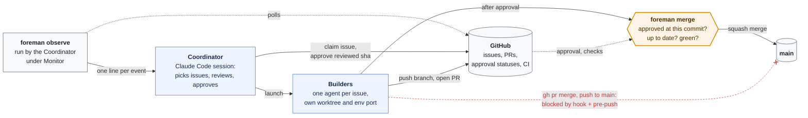
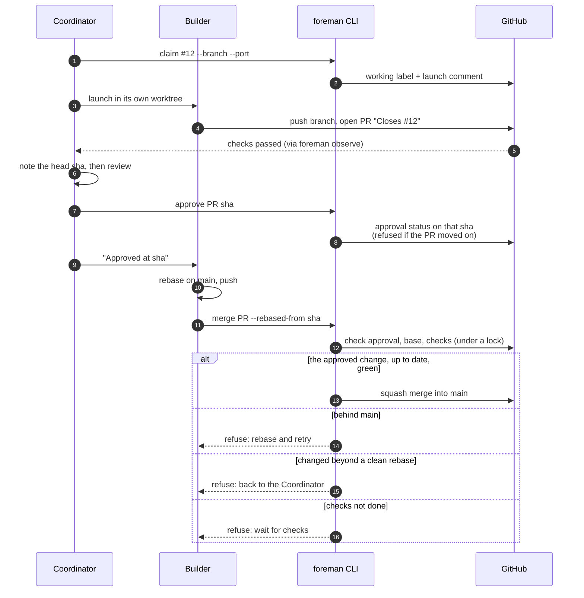
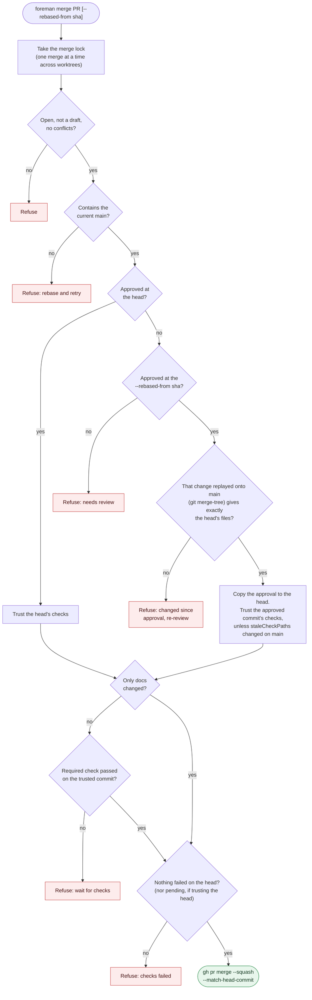

# foreman

Run a crew of coding agents on one GitHub repo, in parallel, without anyone merging what wasn't reviewed.

- A **Coordinator** (a Claude Code session) picks issues, launches one **Builder** per issue in its own worktree and environment, reviews each PR and approves the exact commit it reviewed.
- Each **Builder** takes its issue to a PR, waits for approval, then merges it through `foreman merge`. That command refuses anything that isn't exactly what was approved, up to date and green.
- An **Observer** prints a line whenever something needs the Coordinator's attention.
- **Guards** make the gated path the only path: a Claude Code hook blocks `gh pr merge`, merge API calls, writes to the base branch and hand-written approvals, and git's pre-push check refuses pushes to the base branch.

The state lives on GitHub (labels, comments, commit statuses), so a crashed or rate-limited session picks up where it left off: `foreman status` rebuilds the whole picture.

Extracted from a real migration project, where it ran waves of 3–4 Builders that merged dozens of PRs.



<details><summary>One issue, end to end</summary>



</details>

## Install

Needs Node 20+, git 2.38+, bash and the GitHub CLI (`gh auth login`).

```sh
npm install --save-dev github:smknaqvi/foreman#v0.1.2    # pin a release tag; the package is @smknaqvi/foreman, the command foreman
npx --no-install foreman init          # config, git hook, Claude Code guard, the two playbooks (--ci, --conductor for more)
npx --no-install foreman doctor        # checks it all works
```

Then fill in `foreman.config.json`, create the labels `init` prints, and say in your AGENTS.md / CLAUDE.md which files each kind of work owns. Ask Claude Code to "coordinate the agents on milestone X".

Run it as `npx --no-install foreman` (as the playbooks do), or from an npm script. A different npm package is also called `foreman`, and plain `npx foreman` in a checkout without dependencies installed would download and run that one.

Installing it as a package rather than copying scripts matters: a Builder can't change the merge rules in its own branch and then run them. The rules change only when the version is bumped, and `package.json` is always on the list of risky paths.

## Commands

| | |
|---|---|
| `status` | Base branch CI, which issues have Builders (and on which branch and port), each PR's checks, approval and risky files, recent merges, running environments and orphans |
| `claim <issue> --branch <b> [--port <p>]` / `release <issue>` | Record or drop a Builder on an issue (a label plus a comment `status` reads back) |
| `approve <PR> <sha>` | Approve the commit you reviewed. Refuses if the PR has moved on since |
| `merge <PR> [--rebased-from <sha>]` | The only way in. See [How the gate works](#how-the-gate-works) |
| `observe [--once]` | One line per event: PR opened or closed, checks finished, base CI failed, Docker memory high. Meant for Claude Code's Monitor tool |
| `workspace [--port <p>]` | Prepare a checkout: switch on the pre-push check, give its environment its port (`$CONDUCTOR_PORT` by default) |
| `init [--force] [--ci] [--conductor]` | Set a repo up. Writes only what's missing. `--force` replaces foreman's own files but never a playbook you wrote |
| `doctor` | Tools, config, guards (including a live test of each), labels, required check |
| `guard` | The Claude Code hook itself |

## Configuration

`foreman.config.json` at the repo root. Every field is optional. See [`lib/config.mjs`](lib/config.mjs) for defaults and [`examples/`](examples/).

| Field | What it's for |
|---|---|
| `baseBranch` | The branch PRs target and nothing pushes to (`main`) |
| `requiredCheck` | The CI check `merge` waits for (`verify`). A clean rebase reuses the approved commit's result. Empty: wait for every check on the head |
| `approvalContext` | The commit status that records approval (`coordinator-review`) |
| `labels` | `working`, `needsInput`, `decision` |
| `launchComment` | First words of the comment `claim` writes and `status` reads (`Builder launched`) |
| `planFile` | Where progress is written down. Builders put "Plan updates" in their PRs instead, and the Coordinator applies them |
| `verifyCommand` | What a Builder runs before saying it's done |
| `docsOnly` | Regex: PRs that only change matching files don't wait for checks (`\.md$`) |
| `staleCheckPaths` | When these change on the base (e.g. screenshot baselines), a rebased PR waits for its own checks |
| `riskyPaths` | Get the stricter review. `.github/`, `.claude/`, `.githooks/`, the config and `package*.json` are always included |
| `hotspots` | Files several Builders would want. The Coordinator serializes work on them |
| `playbooks` | Your project's skills or docs that every Builder reads |
| `maxBuilders` | Builders at once |
| `env` | The environment adapter and its options (next section) |
| `observe` | `intervalSeconds`, `memoryHigh`, `memoryCritical` (%) |

## Extending

**Environment adapters** decide how each Builder gets its own running copy of the project. Built in:
- `none`: Builders only edit, test and push.
- `wp-env`: WordPress through `@wordpress/env`, one port per checkout.
- `docker-compose`: one compose project per checkout, with the port set through an env file.

For anything else, write a module and point `env.adapter` at it:

```js
// tools/foreman-env.mjs   →   "env": { "adapter": "./tools/foreman-env.mjs", ...your options }
export default {
  usesDocker: false,                         // true: observe watches Docker memory
  setup({ root, port, options }) { … },      // prepare this checkout to run on `port`
  list({ options }) { return [{ name, port, folder }]; },  // what's running, and which checkout it serves
};
```

[`examples/custom-env.mjs`](examples/custom-env.mjs) runs a plain dev server per checkout.

**Playbooks.** `init` installs two generic skills: `coordinate-agents` for the Coordinator and `work-an-issue` for Builders. Everything specific to your project goes in your own skills or docs, listed under `playbooks`. Examples: how to run the app, what "matches the design" means, extra checks.

**Process knobs.** Change labels, the comment wording, the approval context, the required check, which paths count as risky or stale, and the number of Builders, all in the config.

**As a library.** `import { loadConfig, blockedReason, loadAdapter } from '@smknaqvi/foreman'`.

## How the gate works

1. **Approval is bound to a commit.** `approve` writes a commit status on the reviewed sha, and only if the PR is still at that sha. Anything pushed later is unapproved.
2. **A clean rebase keeps the approval.** `merge --rebased-from <approved sha>` replays the approved commit onto the current base (`git merge-tree`). It accepts the PR only if that gives exactly the PR's files. Then it copies the approval onto the new head. A rebase that needed conflict fixes, or slipped in a change, goes back for review.
3. **Up to date and green.** The PR must contain the current base. The required check must have actually passed: on the head, or on the approved commit for a clean rebase, unless a `staleCheckPaths` path changed since. No check may have failed on the head.
4. **One at a time.** A lock shared by every worktree on the machine serializes merges.
5. **No way around it.**
   - The Claude Code hook reads each Bash command the way bash would. That includes quoting, heredocs, `$(...)`, `bash -c`, `eval`, `xargs`, `env`, `cd` and branch switches.
   - It blocks `gh pr merge`, merge and ref-writing API calls (REST and GraphQL), pushes to the base branch, `--no-verify`, switching off `core.hooksPath`, and writing the approval status by hand.
   - Git's pre-push check catches pushes to the base however they're typed.

<details><summary>Every check <code>foreman merge</code> makes, in order</summary>



</details>

## Limits

- **Guardrails, not security.** The guards stop accidental bypasses, not someone determined to get around them. Where GitHub branch protection is available, also make `approvalContext` and `requiredCheck` required status checks. The guards are then a second layer.
- **The guard reads `foreman.config.json` from the agent's own checkout,** so a Builder that edits it changes what the guard protects locally. The config is always a risky path, so such a PR gets the stricter review, and `merge` itself runs with whatever config the merging checkout has. A broken config makes the guard refuse every `gh` and `git push` command until it's fixed.
- **The hook refuses `gh` and `git push` whenever it can't trust the guard:** when foreman isn't installed, when the installed version isn't the one `package-lock.json` pins (run `npm install` after a rebase that bumped it), or when the guard fails to load.
- **The command guard is Claude Code only.** Other agents get the git pre-push check and the commands, but nothing stops them typing `gh pr merge`.
- **GitHub only.**

## Upgrading

1. Bump the tag in `package.json` (`npm install --save-dev github:smknaqvi/foreman#vX.Y.Z`) and read [CHANGELOG.md](CHANGELOG.md).
2. If the changelog says so, run `npx --no-install foreman init --force` to refresh the hook and the playbooks. Playbooks you wrote yourself are never replaced.
3. Run `npx --no-install foreman doctor`, then open the PR. `package.json` is always a risky path, so the upgrade gets the stricter review.
4. After it merges, every checkout needs `npm install`. Until then the hook refuses `gh` and `git push`, saying which version it expected. Tell running Builders when you ask them to rebase.

## Development

foreman runs on itself. `main` is protected: pull requests only, and all four test jobs must be green. PRs merge through `node bin/foreman.mjs approve` and `merge` (see `foreman.config.json`). Then a release is tagged on `main` and added to the changelog.

```sh
npm test    # the guard's command cases, the merge gate against real git repos and a fake gh, init, config, adapters
```
