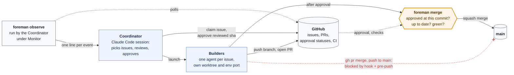
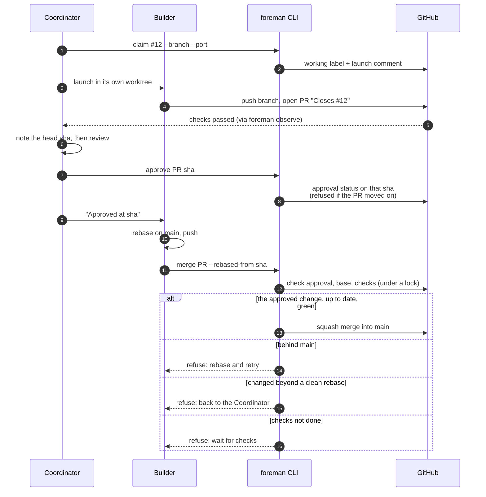

# foreman

Run a crew of coding agents on one GitHub repo, in parallel, without anyone merging what wasn't reviewed.

- A **Coordinator** (a Claude Code session) picks issues, launches one **Builder** per issue in its own worktree and environment, reviews each PR and approves the exact commit it reviewed.
- Each **Builder** takes its issue to a PR, waits for approval, then merges it through `foreman merge`. That command refuses anything that isn't exactly what was approved, up to date and green.
- An **Observer** prints a line whenever something needs the Coordinator's attention.
- **Guards** make the gated path the only path: a Claude Code hook blocks `gh pr merge`, merge API calls, writes to the base branch and hand-written approvals, and git's pre-push check refuses pushes to the base branch.
- A **Watchdog** (optional, no AI) notices when every agent has stopped at a usage limit, merges what's approved and green, and starts a new Coordinator once the limit resets.
- **Notifications** (optional) reach you on Slack, Discord or your phone when something needs a person: an issue labeled for a decision, a red base branch, a usage-limit stop, a Coordinator that finished.
- A **dashboard** (optional, read-only) shows all of it in a browser, live.

The state lives on GitHub (labels, comments, commit statuses), so a crashed or rate-limited session picks up where it left off: `foreman status` rebuilds the whole picture, and the watchdog does it without waiting for a person.

Extracted from a real migration project, where it ran waves of 3–4 Builders that merged dozens of PRs.



<details><summary>One issue, end to end</summary>



</details>

## Install

Needs Node 20+, git 2.38+, bash and the GitHub CLI (`gh auth login`).

```sh
npm install --save-dev github:smknaqvi/foreman#v0.2.1    # pin a release tag; the package is @smknaqvi/foreman, the command foreman
npx --no-install foreman init          # config, git hook, Claude Code guard, the two playbooks (--ci [--self-hosted <labels>], --conductor for more)
npx --no-install foreman doctor        # checks it all works
```

Then fill in `foreman.config.json`, create the labels `init` prints, and say in your AGENTS.md / CLAUDE.md which files each kind of work owns. Ask Claude Code to "coordinate the agents on milestone X".

Run it as `npx --no-install foreman` (as the playbooks do), or from an npm script. A different npm package is also called `foreman`, and plain `npx foreman` in a checkout without dependencies installed would download and run that one.

Installing it as a package rather than copying scripts matters: a Builder can't change the merge rules in its own branch and then run them. The rules change only when the version is bumped, and `package.json` is always on the list of risky paths.

## Commands

| | |
|---|---|
| `status` | Base branch CI and self-hosted runners, which issues have Builders (and on which branch and port), each PR's checks, approval and risky files, recent merges, whether the last agent session stopped at a usage limit, the watchdog, running environments and orphans |
| `claim <issue> --branch <b> [--port <p>]` / `release <issue>` | Record or drop a Builder on an issue (a label plus a comment `status` reads back) |
| `approve <PR> <sha>` | Approve the commit you reviewed. Refuses if the PR has moved on since |
| `merge <PR> [--rebased-from <sha>]` | The only way in. See [How the gate works](#how-the-gate-works) |
| `observe [--once]` | One line per event: PR opened or closed, checks finished, a preview deployment ready, base CI failed, Docker memory high. Meant for Claude Code's Monitor tool. Also sends [notifications](#notifications) |
| `dashboard [--port <p>] [--open]` | The crew in a browser, live: what `status` shows plus a feed of what `observe` would print. See [Dashboard](#dashboard) |
| `tick [--dry-run]` | The steps that need no judgement: rebase approved, green PRs onto the base (clean rebases only) and merge them through `merge`; remove orphaned environments. Never reviews or approves |
| `watchdog install\|uninstall\|status\|pause\|unpause\|stop\|run` | Keeps the crew going after a usage limit. See [When every agent stops](#when-every-agent-stops) |
| `env start [--port <p>]` | Start this checkout's dev server in the background on its port and wait until it listens (`dev-server`, `nextjs`, `rails`) |
| `env remove [--port <p>]` | Remove this checkout's environment, running or stopped, and anything on that port. For CI on a machine that isn't wiped between jobs |
| `notify add\|remove\|on\|off\|test\|check\|list` | Where notifications go and which events send them. See [Notifications](#notifications) |
| `workspace [--port <p>]` | Prepare a checkout: switch on the pre-push check, give its environment its port (`$CONDUCTOR_PORT` by default) |
| `init [--force] [--ci [--self-hosted <labels>]] [--conductor]` | Set a repo up. Writes only what's missing. `--force` replaces foreman's own files but never a playbook you wrote. `--self-hosted`: the check runs on your own runner ([below](#running-the-checks-on-your-own-machine)) |
| `doctor` | Tools, config, guards (including a live test of each), labels, required check |
| `guard` | The Claude Code hook itself |
| `guard --self-test` | The hook and the pre-push check refuse what they should. Needs no GitHub access, so CI can run it on every PR |

## Configuration

`foreman.config.json` at the repo root. Every field is optional. See [`lib/config.mjs`](lib/config.mjs) for defaults and [`examples/`](examples/).

| Field | What it's for |
|---|---|
| `baseBranch` | The branch PRs target and nothing pushes to (`main`) |
| `requiredCheck` | The CI check `merge` waits for (`verify`). A clean rebase reuses the approved commit's result. Empty: wait for every check on the head |
| `approvalContext` | The commit status that records approval (`coordinator-review`) |
| `labels` | `working`, `needsInput`, `decision` |
| `launchComment` | First words of the comment `claim` writes and `status` reads (`Builder launched`) |
| `planFile` | Where progress is written down. Builders put "Plan updates" in their PRs instead, and the Coordinator applies them |
| `verifyCommand` | What a Builder runs before saying it's done |
| `docsOnly` | Regex: PRs that only change matching files don't wait for checks (`\.md$`) |
| `staleCheckPaths` | When these change on the base (e.g. screenshot baselines), a rebased PR waits for its own checks |
| `riskyPaths` | Get the stricter review. `.github/`, `.claude/`, `.githooks/`, the config and `package*.json` are always included |
| `hotspots` | Files several Builders would want. The Coordinator serializes work on them |
| `playbooks` | Your project's skills or docs that every Builder reads |
| `maxBuilders` | Builders at once |
| `env` | The environment adapter (or a list of them) and its options (next section) |
| `observe` | `intervalSeconds`, `memoryHigh`, `memoryCritical` (%) |
| `watchdog` | `everyMinutes` (15), `staleMinutes` (0: act only after a usage-limit stop), `maxSessionsPerDay` (6), `dir` (the Coordinator's worktree), `setup`, `command`, `prompt`, `env`. See [When every agent stops](#when-every-agent-stops) |

## Extending

**Environment adapters** decide how each Builder gets its own running copy of the project. Built in:
- `none`: Builders only edit, test and push.
- `wp-env`: WordPress through `@wordpress/env`, one port per checkout.
- `docker-compose`: one compose project per checkout, with the port set through an env file.
- `nextjs`: a Next.js dev server per checkout (`next dev --port <port>`).
- `rails`: a Rails server per checkout (`bin/rails server --port <port>`).
- `dev-server`: any other dev server: set `command`, e.g. `["npm", "run", "dev", "--", "--port", "{port}"]`.
- `neon`: a [Neon](https://neon.tech) database branch per checkout, its connection string written to an env file.

The three dev-server adapters work the same way. `foreman workspace --port <p>` records the checkout's port, `foreman env start` runs the server in the background with `PORT` set and waits until it listens, and `foreman env remove` stops it. A server is whatever listens on a port a checkout recorded (found with `lsof`), so one started by hand counts too. Their options:
- `command`: what starts the server. `{port}` and `{checkout}` (the checkout folder's name) are filled in.
- `cwd`: the app's folder, for a monorepo.
- `vars`: more environment variables, e.g. `{ "DATABASE_URL": "postgres://localhost/app_{checkout}" }`, so each checkout has its own database. Rails shares one development database between checkouts unless you set this.
- `envFile`: also write `PORT` and `vars` to this file. foreman warns if git tracks the file.
- `startTimeout`: how long `env start` waits for the port to open, in seconds (default 120).

`neon` makes the branch `foreman/<checkout>-<hash>` from `parent` (default: the project's default branch) when `foreman workspace` runs, or reuses it. It writes `DATABASE_URL` (`variable`) to `.env` (`envFile`). The API key comes from `NEON_API_KEY` in the environment, never from the config. Other options: `projectId` (or `NEON_PROJECT_ID`), `database`, `role`, `pooled`, `prefix`. Each branch is recorded with the checkout it serves, so `foreman tick` deletes branches whose checkout is gone. Branches made on another machine are listed but never touched. Neon's free plan has a limited number of branches: `foreman env remove` a Builder's branch when you're done with it.

**Several at once.** `adapter` may be a list. Each adapter does its part in order, with the shared options plus the object under its own name:

```json
"env": {
  "adapter": ["nextjs", "neon"],
  "neon": { "projectId": "late-sky-123456", "envFile": ".env.local" },
  "nextjs": { "vars": { "NEXTAUTH_URL": "http://localhost:{port}" } }
}
```

**Preview deployments** need no adapter. Vercel, Netlify, Cloudflare Pages and Render report to GitHub's Deployments API, so `status`, `observe` and the dashboard show each PR head's live preview URL (production deployments don't count). A Coordinator reviewing visual work can open the preview instead of starting the Builder's environment.

For anything else, write a module and point `env.adapter` at it:

```js
// tools/foreman-env.mjs   →   "env": { "adapter": "./tools/foreman-env.mjs", ...your options }
export default {
  usesDocker: false,                         // true: observe watches Docker memory
  setup({ root, port, options }) { … },      // prepare this checkout to run on `port`
  start({ root, port, options }) { … },      // optional: foreman env start
  list({ root, options }) { return [{ name, port, folder }]; },  // what's running, and which checkout it serves
  remove({ options, env, root, port }) { … },  // optional: one entry from list(), or this checkout's (and port's)
};
```

[`examples/custom-env.mjs`](examples/custom-env.mjs) runs a plain dev server per checkout.

**Playbooks.** `init` installs two generic skills: `coordinate-agents` for the Coordinator and `work-an-issue` for Builders. Everything specific to your project goes in your own skills or docs, listed under `playbooks`. Examples: how to run the app, what "matches the design" means, extra checks.

**Process knobs.** Change labels, the comment wording, the approval context, the required check, which paths count as risky or stale, and the number of Builders, all in the config.

**As a library.** `import { loadConfig, blockedReason, loadAdapter } from '@smknaqvi/foreman'`.

## When every agent stops

A Claude Code session that hits a usage limit stops, and so do the Builders it launched. The work is all on GitHub, but nothing picks it up until someone opens a new session. The watchdog does that part without AI:

```sh
npx --no-install foreman watchdog install   # macOS: a launchd job; elsewhere it prints a cron line
npx --no-install foreman watchdog status    # what it did, and what a round would do now
```

Every `everyMinutes` a round runs. It does nothing while paused, while a Coordinator it started is still running, or when nothing is in flight (no claimed issue, no approved PR). Otherwise it looks at the Claude Code sessions working in this repo (their transcripts on this machine, in every worktree):

- **Agents are working:** nothing, except merging approved, green PRs nobody has touched for 10 minutes. Not even that while a Coordinator's `foreman observe` is running (it finished a round in the last 5 minutes, or 3 of its intervals): the Coordinator is waiting on checks and may be holding an approved PR back on purpose.
- **The newest session stopped at a usage limit** ("You've hit your session limit · resets 1:50am"): it runs `foreman tick` right away (merging needs no AI, so that happens during the limit), and once the limit has reset it starts a Coordinator in the background in its own worktree (`watchdog.dir`, by default beside the main checkout): `claude -p` with a prompt to resume as Coordinator, finish only what's in flight, and run Builders in the foreground so the session lasts.
- **Nothing for `staleMinutes`:** the same, if you set it (off by default: silence alone usually means a person is away, not that a limit hit).

A Coordinator that hits the limit again just ends, and a later round tries again. One that ends normally isn't restarted until the work in flight changes, and at most `maxSessionsPerDay` start in a day. Its session id is recorded, so `claude --resume <id>` (from its worktree) carries on with it by hand. Each start and finish is a [notification](#notifications) (on macOS, a system notification even with none set up).

`foreman status` shows a running watchdog Coordinator; an interactive Coordinator shouldn't start alongside it (`watchdog stop` hands over). `watchdog pause` holds rounds, `uninstall` removes the job. State, log and session output are in `<git common dir>/foreman/watchdog/`.

## Notifications

The Coordinator reports to you when you're at the screen. When you're not, `foreman notify` tells you what needs a person:

```sh
npx --no-install foreman notify add ntfy my-crew-7f3k          # your phone, through the ntfy app (pick an unguessable topic)
npx --no-install foreman notify add slack '$SLACK_WEBHOOK_URL' # read from the environment when sending (quote the $)
npx --no-install foreman notify add discord https://discord.com/api/webhooks/…
npx --no-install foreman notify add webhook https://example.com/hook       # JSON: kind, repo, title, text, url, urgent, at
npx --no-install foreman notify add command -- terminal-notifier -title {title} -message {text} -open {url}
npx --no-install foreman notify test                           # sends a test to each
npx --no-install foreman notify                                # targets, and which events are on
```

| Event | Default | When |
|---|---|---|
| `needs-people` | on | An open issue or PR has `labels.decision` or `labels.needsInput`. The notification includes its latest comment, which is usually what the Builder needs. Removing the label and adding it again sends again |
| `base-failed` | on | A push run on the base branch failed |
| `limit` | on | The newest agent session stopped at a usage limit with work in flight (with when it resets) |
| `coordinator` | on | The watchdog started a Coordinator, or one ended (with its summary: what merged, what waits on whom) |
| `held` | on | The watchdog won't start another Coordinator: the last ended with the same work in flight, or `maxSessionsPerDay` |
| `merged` | off | The watchdog merged an approved PR |
| `checks-failed` | off | A PR's checks failed |
| `preview` | off | A PR's preview deployment is ready |

`notify on|off <event>` changes these. `foreman observe` sends events while a Coordinator watches. The watchdog checks every round, even when it has nothing else to do, so with the watchdog installed a labeled issue reaches you within `everyMinutes`. Without it, run `notify check` from cron. Every event has a key, and only the first process to claim it sends it, so the Observer and the watchdog never both send one.

Targets belong to your machine, not the repo: they're kept in `<git common dir>/foreman/notify.json`, never committed, because webhook URLs are secrets. With no targets, macOS still shows the watchdog's Coordinator notifications, as before. `FOREMAN_NO_NOTIFY=1` silences everything.

## Dashboard

```sh
npx --no-install foreman dashboard --open     # http://127.0.0.1:4477
```

One page with:
- what needs you (labeled issues with their latest comment),
- each Builder's issue and PR (checks, approval, ready to merge, risky files, preview link),
- other open PRs and recent merges,
- the base branch's CI, the agents and watchdog, and local environments (orphans marked),
- a live feed of what `foreman observe` would print, plus the watchdog's rounds.

It's **read-only** on purpose: approving means reviewing, which is the Coordinator's job, so nothing on the page approves, merges, claims or starts anything. It listens on 127.0.0.1 only and refuses requests whose `Host` isn't this machine. Its observer state lives in memory, so it doesn't change what the Coordinator's `foreman observe` reports, and the watchdog doesn't take it for a Coordinator watching.

## How the gate works

1. **Approval is bound to a commit.** `approve` writes a commit status on the reviewed sha, and only if the PR is still at that sha. Anything pushed later is unapproved.
2. **A clean rebase keeps the approval.** `merge --rebased-from <approved sha>` replays the approved commit onto the current base (`git merge-tree`). It accepts the PR only if that gives exactly the PR's files. Then it copies the approval onto the new head. A rebase that needed conflict fixes, or slipped in a change, goes back for review.
3. **Up to date and green.** The PR must contain the current base. The required check must have actually passed: on the head, or on the approved commit for a clean rebase, unless a `staleCheckPaths` path changed since. No check may have failed on the head.
4. **One at a time.** A lock shared by every worktree on the machine serializes merges.
5. **No way around it.**
   - The Claude Code hook reads each Bash command the way bash would. That includes quoting, heredocs, `$(...)`, `bash -c`, `eval`, `xargs`, `env`, `cd` and branch switches.
   - It blocks `gh pr merge`, merge and ref-writing API calls (REST and GraphQL), pushes to the base branch, `--no-verify`, switching off `core.hooksPath`, and writing the approval status by hand.
   - Git's pre-push check catches pushes to the base however they're typed.

<details><summary>Every check <code>foreman merge</code> makes, in order</summary>


</details>

## Running the checks on your own machine

A crew of agents runs a lot of CI. When hosted minutes run out, a self-hosted runner (a Mac with Docker, say) can run the required check: `npx --no-install foreman init --ci --self-hosted <labels>` writes a workflow for it that:

- keeps a Mac awake for the job only (`.github/foreman/keep-awake.sh`): a Mac that sleeps mid-job loses the runner's connection,
- skips npm's audit (its advisory service can take minutes) and relies on the runner's own npm cache,
- removes the job's environment before (a cancelled job's leftovers) and after (`foreman env remove`), since the runner isn't wiped between jobs.

While the runner is offline, runs wait as **queued** and start when it's back: that isn't a failure, so agents shouldn't re-push (`foreman status` lists the runners). A self-hosted runner runs every PR's code with its own user's permissions: keep the repo **private**, with only people and agents you trust pushing, while it's attached.

**PRs opened by a workflow** (a scheduled dependency bump, say) don't start other workflows when they're opened with the job's `GITHUB_TOKEN`. Have that workflow start the check with `gh workflow run verify.yml --ref <branch>` (add `workflow_dispatch:` to the check's triggers). Its check run lands on the branch's commit, which is what `foreman merge` reads; GitHub doesn't list a dispatched run on the PR, so also post the result as a commit status with the check's name (a first step setting `pending`, a last `if: always()` step setting the result) for `gh pr checks` to see.

**A check that depends on the current branch** can pass on PRs and fail on the base: PR checks run on a detached commit, the base branch's run on the branch itself.

## Limits

- **Guardrails, not security.** The guards stop accidental bypasses, not someone determined to get around them. Where GitHub branch protection is available, also make `approvalContext` and `requiredCheck` required status checks. The guards are then a second layer.
- **The guard reads `foreman.config.json` from the agent's own checkout,** so a Builder that edits it changes what the guard protects locally. The config is always a risky path, so such a PR gets the stricter review, and `merge` itself runs with whatever config the merging checkout has. A broken config makes the guard refuse every `gh` and `git push` command until it's fixed.
- **The hook refuses `gh` and `git push` whenever it can't trust the guard:** when foreman isn't installed, when the installed version isn't the one `package-lock.json` pins (run `npm install` after a rebase that bumped it), or when the guard fails to load.
- **The command guard is Claude Code only.** Other agents get the git pre-push check and the commands, but nothing stops them typing `gh pr merge`.
- **The watchdog reads Claude Code's transcripts** (`~/.claude/projects/`) to tell a usage-limit stop from agents that are just waiting. They're Claude Code's own files, not an API: if their shape changes it stops seeing limits (set `staleMinutes` as a fallback). It starts Claude with `--permission-mode bypassPermissions` (`watchdog.command`), because nobody is there to approve tools; the merge guard hook still applies.
- **GitHub only.**

## Upgrading

1. Bump the tag in `package.json` (`npm install --save-dev github:smknaqvi/foreman#vX.Y.Z`) and read [CHANGELOG.md](CHANGELOG.md).
2. If the changelog says so, run `npx --no-install foreman init --force` to refresh the hook and the playbooks. Playbooks you wrote yourself are never replaced.
3. Run `npx --no-install foreman doctor`, then open the PR. `package.json` is always a risky path, so the upgrade gets the stricter review.
4. After it merges, every checkout needs `npm install`. Until then the hook refuses `gh` and `git push`, saying which version it expected. Tell running Builders when you ask them to rebase.

## Development

foreman runs on itself. `main` is protected: pull requests only, and all four test jobs must be green. PRs merge through `node bin/foreman.mjs approve` and `merge` (see `foreman.config.json`). Then a release is tagged on `main` and added to the changelog.

```sh
npm test    # the guard's command cases, the merge gate against real git repos and a fake gh, init, config, adapters,
            # notifications, observe rounds and the dashboard
```
